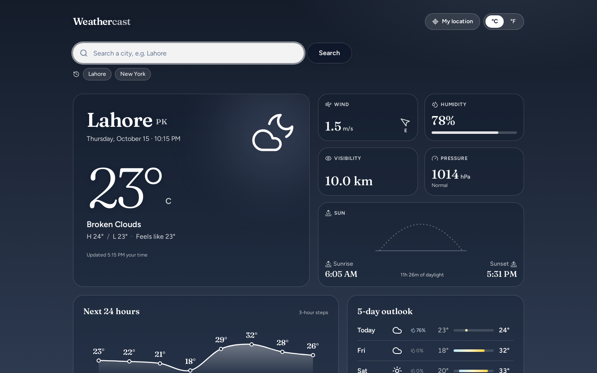
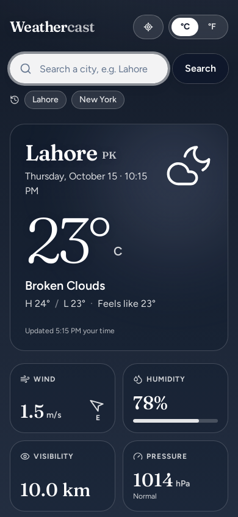

<div align="center">

# 🌤️ Weather Forecast App

Current conditions, a 24-hour forecast and a 5-day outlook for any city in the world, built with Next.js, React and the OpenWeatherMap API.


**[▶ Live demo: weathercast-zain.vercel.app](https://weathercast-zain.vercel.app)**

&nbsp;

</div>

---

## Design

The page is a sky that follows the weather: the background changes with the condition (clear, clouds, rain, storm, snow, mist) and with day or night in the searched city. Text sits on frosted panels so it stays readable on every sky. Headings and numbers use Fraunces; body text uses Figtree.

- **Hero card:** city, local date and time, a large temperature, the condition, today's high and low, and "feels like"
- **Detail tiles:** wind speed with a direction arrow, humidity with a fill bar, visibility, pressure with a low/normal/high hint, and a **sun arc** that shows where the sun is between sunrise and sunset, plus the hours of daylight
- **Next 24 hours:** a smooth temperature curve with icons (day or night), times and chance of rain for each 3-hour step; scrolls sideways on phones
- **5-day outlook:** one row per day with the condition around midday, chance of rain, and a low-to-high range bar on a shared scale
- **States:** skeleton while loading, a frosted error panel with **Try again**, and recent searches as one-tap chips

## Features

- **City search:** look up the weather for any city by name (opens on New York); the last five cities are saved in your browser
- **My location:** uses the browser's geolocation and loads the weather by coordinates
- **°C / °F toggle:** reloads the data in metric or imperial units
- **City-local times:** sunrise, sunset, hourly times and day names use the searched city's time zone, not yours
- **Daily highs and lows** are worked out from all the 3-hour readings for each day
- **Accessible:** labelled controls, visible focus, screen-reader text for the chart and range bars, reduced-motion support

## Tech stack

| Layer | Tools |
|---|---|
| Framework | Next.js 16 (App Router), React 19 |
| Language | TypeScript |
| UI | Tailwind CSS 4, Lucide icons, Fraunces + Figtree via Fontsource |
| Data | [OpenWeatherMap API](https://openweathermap.org/api) (Current Weather + 5 day / 3 hour Forecast) |

## Getting started

**Requirements:** Node.js 18.18 or newer and a free OpenWeatherMap API key ([sign up here](https://home.openweathermap.org/users/sign_up)).

```bash
git clone https://github.com/ZainAftab-dev/Weather-App.git
cd Weather-App
npm install
```

Add your API key in a `.env.local` file:

```bash
NEXT_PUBLIC_OPENWEATHER_API_KEY=your_openweathermap_api_key
```

(Without it the app falls back to the demo key in `lib/weather.ts`, which may be rate-limited.)

Then start the app:

```bash
npm run dev
```

Open [http://localhost:3000](http://localhost:3000). For a production build: `npm run build` then `npm start`.

> New OpenWeatherMap keys can take up to two hours to activate. If you see "Invalid API key", wait and try again.

## API endpoints used

| Endpoint | Used for |
|---|---|
| `GET /data/2.5/weather?q={city}` | Current weather by city name |
| `GET /data/2.5/weather?lat={lat}&lon={lon}` | Current weather for "My Location" |
| `GET /data/2.5/forecast?q={city}` | Hourly (first 8 × 3 h) and 5-day forecasts |

## Project structure

```
app/
├── layout.tsx               # root layout and metadata
├── page.tsx                 # state, loading, geolocation, unit toggle, recent searches
├── loading.tsx              # loading state
├── actions.ts               # server-action versions of the API calls (reads OPENWEATHER_API_KEY)
└── globals.css
components/
├── search-bar.tsx           # city search and recent-city chips
├── current-weather.tsx      # hero card
├── weather-details.tsx      # wind, humidity, visibility, pressure, sun arc
├── hourly-forecast.tsx      # temperature curve for the next 24 hours
├── daily-forecast.tsx       # 5-day rows with range bars
├── weather-icon.tsx         # condition → Lucide icon (day/night)
└── loading-spinner.tsx      # loading skeleton
lib/
└── weather.ts               # API calls, types, time-zone helpers, daily grouping, sky themes
```

## Troubleshooting

| Problem | Fix |
|---|---|
| "City not found" | Check the spelling, or add the country code, e.g. `Lahore,PK` |
| My Location does nothing | Allow location access in the browser; geolocation needs `https` or `localhost` |
| "Invalid API key" | Check `NEXT_PUBLIC_OPENWEATHER_API_KEY`; new keys need time to activate |

## Deployment

Live at [weathercast-zain.vercel.app](https://weathercast-zain.vercel.app). To deploy your own copy, import the repository into [Vercel](https://vercel.com/new), add `NEXT_PUBLIC_OPENWEATHER_API_KEY` under Environment Variables, and deploy.

## Screenshots

The screenshots above are taken from the live site by the **Update screenshots** GitHub Action (`.github/workflows/screenshots.yml`). Run it from the Actions tab to refresh them after a redesign.

## Author

**Zain Aftab** · [GitHub](https://github.com/ZainAftab-dev) · [LinkedIn](https://www.linkedin.com/in/zain-aftab-563727295/)

## License

[MIT](LICENSE)
